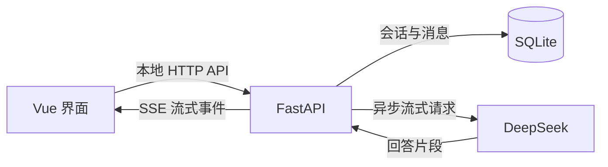

# EchoChat 本地后端方案

## 目标与使用范围

第一版供个人在本机使用。统一助手支持快速回答、深度思考、附件、语音输入、会话管理和主题功能，使用 Python FastAPI 后端接管模型调用、会话业务与数据存储。

采用 SQLite，无需安装 MySQL。前端和后端继续位于 `echochat` 同一个仓库。前后端通过本地 API 协作，数据库迁移随后端启动执行。

## 架构与职责

| 部分 | 职责 |
|---|---|
| Vue | 输入与附件选择、浏览器语音识别、消息展示、Markdown、复制、滚动、主题、临时草稿 |
| FastAPI | 会话和消息操作、助手及模式配置、模型上下文组装、附件解析、DeepSeek 请求、生成生命周期 |
| SQLite | 会话、消息、附件提取文本、生成状态、错误与完成原因 |

数据库成为聊天历史的唯一持久化来源。Pinia 保存界面所需的数据副本，不再把整份聊天历史写入 localStorage。主题、最后选中的会话和模式偏好可以继续保存在浏览器；未发送草稿按会话区分。

统一助手提示词、支持的模式及其 DeepSeek 参数在后端集中定义，前端通过配置接口获取名称和可选值。快速回答和深度思考均使用 `deepseek-flash`，分别显式关闭或开启思考。API Key 在运行时配置，由后端用于调用 DeepSeek。

## 页面输入 API Key

提供密钥输入框，以及使用、更换和清除操作。密钥缺失时提示先配置；前端提交到本地后端后清空输入值，配置接口仅返回是否已配置，不回传完整密钥。聊天请求由后端附加 DeepSeek 鉴权信息。

第一版采用临时保存：密钥仅保留在本地后端进程内存中，主动清除或重启后端后失效，刷新页面仍可继续使用。聊天记录正常保存到数据库，密钥不写入源码、前端构建产物、localStorage、数据库或日志。这里的临时保存不承诺关闭浏览器就立即清除后端内存。

后续若需要“记住本机”，再使用系统凭据存储；若扩展为账号级保存，则设计与用户绑定的加密存储和删除机制。输入页面不代替后端的密钥保护和用户隔离。

浏览器存储可被同源脚本读取，因此不建议把密钥加入现有 Pinia 持久化状态：[OWASP 浏览器存储说明](https://cheatsheetseries.owasp.org/cheatsheets/HTML5_Security_Cheat_Sheet.html#local-storage)。

## 数据库与本地运行

技术组合：FastAPI、Pydantic、HTTPX、SQLAlchemy、Alembic、SQLite。数据库异步访问使用 aiosqlite，DeepSeek 请求使用复用的 HTTPX AsyncClient。

SQLite 是后端直接访问的数据库文件，无需独立数据库服务，也不要求安装图形管理工具。数据目录为 `backend/data/echochat.db`；数据库、本地环境文件与临时上传文件均排除出 Git。

第一版后端以单进程运行，仅监听 `127.0.0.1`，校验本地 Host 和允许的 Origin。开发时 Vue 通过 Vite 将 `/api` 代理到后端，避免在组件里写死后端地址。

数据库使用短事务，启用外键约束和 WAL。等待模型生成时不持有写事务或数据库连接；片段按时间批量保存，每秒保存一次，完成、取消和失败时立即保存终态。突然断电可能损失最后一次保存后的少量片段；重新启动会把遗留的生成中消息标记为中断。

数据库表结构通过 Alembic 迁移升级，不在升级时删除重建聊天数据。最简单的备份方式是正常停止后端后备份数据目录；运行中备份应使用 SQLite 备份接口，不能只随意复制一个正在使用的 db 文件。

未来需要多实例部署或大量并发写入时，再评估 MySQL 等服务型数据库。SQLAlchemy 能减少适配工作，但数据库切换仍需要迁移数据、核对约束和验证查询，不能承诺只改连接字符串。

SQLite 官方说明其适用于本地应用及一定规模的网站，主要并发限制是同一时刻只有一个写入者：[SQLite 使用场景](https://www.sqlite.org/whentouse.html)。[WAL 文档](https://www.sqlite.org/wal.html)说明了日志文件及相关运行约束。

## 数据模型

业务数据先使用三张表。数据库迁移工具另行维护版本表。

| 表 | 关键字段与作用 |
|---|---|
| `conversations` | 稳定 ID、标题及其来源、助手标识、当前上下文段、创建及更新时间、可选的旧数据导入标识 |
| `messages` | 稳定 ID、会话 ID、单调递增顺序号、user/assistant、正文、思考内容、助手标识、上下文段、模式、关联用户消息 ID、请求 ID、状态、错误码、完成原因 |
| `attachments` | ID、所属消息 ID、文件名、大小、类型、提取文本、解析状态、截断及解析说明 |

会话 ID 与标题分离，允许不同会话同名；重命名只修改目标会话标题。消息 ID 不随删除和排序变化，前端列表与流式更新都使用消息 ID。

新建空白会话保持待输入状态，首次保存消息后才进入历史列表；重复点击新建时复用尚未使用的空白会话。

首次提问提取纯文本标题；仅有附件时使用文件名。手动重命名会标记为手动标题，后续发送和重启都不覆盖。已有默认标题在启动时补齐；历史摘要经 Markdown 解析转为纯文本后截断。

每条助手消息通过可空外键关联同一会话中的用户消息。单条删除保持现有范围，不自动删除整轮；删除用户消息时将关联置空，对应助手消息不能再重新生成。删除会话级联删除它的消息和附件。

## 聊天与生成规则

### 发送和流式结果

1. 前端生成请求 ID，提交会话 ID、当前输入、模式和本次附件。历史消息与系统提示词由后端读取和组装。
2. 后端校验模式、内容、附件和生成状态，通过后在短事务中保存用户消息及生成中的助手消息。
3. 每个请求固定会话 ID、助手消息 ID、请求 ID 及上下文快照。所有回调只修改该目标。
4. 后端请求 DeepSeek，分别转发思考和回答片段；保存最终内容和状态后再发出完成事件。思考过程默认折叠，保存在历史中，刷新后仍可展开查看。
5. 保留的请求记录用于重复请求去重；当前后端进程也记住已删除记录的请求 ID，防止延迟重试再次调用模型。删除记录并重启后不保留该请求 ID 的去重信息。请求结果不确定时，前端查询数据库中的消息状态，不自动重试生成。

首版同一时刻只执行一个生成请求。按钮、Enter 和后端入口统一检查；后端忙碌返回明确冲突。后续若需要并行会话，再单独调整这一规则。

切换会话仅切换展示，正在生成的回复继续写入原会话。新建会话不会改变原请求目标。停止按钮操作固定的请求 ID，关闭上游连接，保存已收到的部分回答并标记已取消。取消接口等待处理完成后返回落库消息；前端停止接收旧片段并以该消息校准正文和状态，再释放队列。流已断开时通过消息查询接口确认结果。

前端刷新、关闭或连接断开时，后端取消关联上游请求并尽力保存终态。服务崩溃后的遗留状态在下一次启动时标记中断，不自动重新计费调用模型。

### 状态与错误

助手消息状态使用 `generating`、`completed`、`cancelled`、`failed`、`interrupted`。完成原因另存 `finish_reason`，区分自然结束与长度截断等情况。

流开始前的校验失败使用 HTTP 错误；流开始后的异常通过错误事件通知前端，并更新数据库中的实际消息。错误说明与模型正文分开存储，不把界面错误提示拼入后续模型上下文。

空失败回复不进入模型上下文；取消后已有的非空回答可以继续作为历史，界面明确标注未完成。上下文超限给出清晰错误，不静默丢弃历史或自动增加摘要功能。

### 上下文和重新生成

所有新对话使用统一助手。旧通用和程序员记录统一助手标识，同时保留原有上下文分段；新请求继续使用当前段，历史内容保留展示。

重新生成使用目标回复所属的上下文段，模式使用当前选择。它保留目标之前的记录，替换目标回复并删除其后的记录；存在后续记录时，执行前明确提示删除范围。后端先校验并固定目标的关联用户消息和上下文段，仅使用该段截至关联用户消息的剩余历史，再在事务中截断并创建新回复。新生成失败时保留明确失败记录，可再次重试。

重新生成历史回复后，会话当前上下文段恢复为该目标所属值；这一更新与截断、创建新回复在同一事务完成。关联用户消息不存在或上下文无法确认时，明确拒绝重新生成，避免发出只有 system 的请求。

生成期间，影响当前上下文的删除和清空必须经过后端检查。删除正在生成的回复或所属会话时，先完成取消再删除；晚到回调不能重新创建已删除数据。

## 附件与浏览器能力

附件随发送请求一并提交，采用 multipart 表单，避免增加独立上传和未绑定附件的管理流程。前端选择文件后先显示名称和大小，后端负责最终类型、大小校验与正文提取。

- 单文件最多 8 MiB，每次最多 10 个文件、合计 24 MiB。
- 文本及已允许的代码扩展名按文本读取，不依赖浏览器是否提供正确 MIME。
- PDF 和 DOCX 使用后端解析库提取正文，解析工作不阻塞聊天事件循环。
- 每个附件统一保留并发送前 8000 字符，明确标注截断，不再额外截成 4000 字符。
- 原文件只在解析期间使用，完成后释放；数据库保存提取文本和元信息，覆盖现有附件能力。
- `.doc` 和无可提取文本的 PDF 明确显示正文不可用，仅提供元信息；损坏文件或实际解析异常明确报错，保留输入供用户修正，不伪装成解析成功。

语音识别继续使用浏览器能力，修正重复追加已识别文本和中文输入法回车误发。Markdown 保留代码高亮、表格和复制，关闭原始 HTML 执行；复制纯文本与复制 Markdown 按各自名称返回对应内容。

附件解析迁到后端后，删除前端不再使用的 PDF/DOCX 解析依赖。其他性能调整以实际验证结果为依据。

## 接口范围

| 接口 | 用途 |
|---|---|
| `GET /api/options` | 角色与模式列表、附件限制 |
| `GET/PUT/DELETE /api/credentials/deepseek` | 查询配置状态、设置或清除运行时密钥 |
| `GET/POST /api/conversations` | 列出、搜索和新建会话 |
| `PATCH/DELETE /api/conversations/{id}` | 重命名、删除会话 |
| `DELETE /api/conversations` | 清空全部会话 |
| `GET /api/conversations/{id}/messages` | 按顺序分页读取消息及附件 |
| `POST /api/conversations/{id}/messages` | 提交文本和附件，返回 SSE |
| `GET/DELETE /api/messages/{id}` | 查询或删除单条消息 |
| `POST /api/messages/{id}/regenerate` | 重新生成，返回 SSE |
| `POST /api/generations/{request_id}/cancel` | 取消指定生成 |
| `POST /api/import/local-history` | 一次性导入旧浏览器历史 |

SSE 约定四类事件：`started` 返回实际消息 ID，`delta` 返回新增正文，`done` 返回保存后的终态和最终正文，`error` 返回错误及对应消息。前端继续用 fetch 读取 POST 流，通过 AbortController 关闭连接；请求及队列状态由独立聊天逻辑管理，避免绑定到当前展示会话。队列按请求隔离，完成前处理尾片段并校准最终正文，取消时清理待执行帧。

历史搜索保持标题和最后一条消息摘要的现有范围。日志记录请求 ID、耗时、终态和上游错误类型，不记录密钥和完整聊天正文。

## 旧数据迁移

旧版聊天记录保存在浏览器 localStorage。新页面与旧页面地址不同可能无法直接读取同一份缓存，因此应同时支持从当前可见缓存导入，以及在旧页面导出快照后导入。

导入在事务中生成稳定 ID，保留消息顺序、附件正文与最近上下文边界，统一旧助手标识。自定义标题保留，默认标题从提问补齐。相同快照重复导入不重复新增；导入标识与快照中的会话标识一同保存。

旧数据没有完整的每条消息生成时间、模型快照和历史上下文段信息，不推测补齐。缺失字段明确留空，能确定的最近上下文段继续正常聊天；无法确认上下文的更早消息限制重新生成。

导入结果展示会话及消息数量，原浏览器数据保留供核对。后续聊天读写统一走后端，不同时维护浏览器与数据库两套历史。

## 后续登录与扩展

FastAPI 和 SQLite 可以承载账号登录及少量用户使用。增加登录与更换数据库是两个独立决策：登录解决身份与数据归属；数据库升级主要由并发写入、部署实例数量及运维要求决定。

第一版为后续扩展保留三个明确边界：会话、消息使用稳定 ID；会话业务集中在服务层；数据库读写集中维护。前端不直接控制数据库字段或提交可信用户身份。注册、登录和权限在进入多用户阶段时完整实现。

加入登录时，扩展内容包括：

1. 增加用户表和登录会话管理，后端统一解析当前登录用户。密码使用成熟库哈希，登录状态支持过期和退出。
2. 为会话增加 `owner_id` 外键。消息和附件通过所属会话确定归属，避免在多张表复制不一致的用户信息。
3. 所有列表、读取、修改、删除、清空、重新生成、停止生成和历史导入都由后端按当前用户检查权限。仅隐藏前端入口不能实现隔离。
4. 将旧本地历史迁入明确指定的个人账号，完成归属回填和非空约束后再开放多用户访问；不能让第一位注册者自动认领旧记录。
5. 生成限制从本地应用级调整为用户级，并设置服务总并发和用量限制，避免一个用户影响其他用户或耗尽共享模型额度。

FastAPI 可以通过依赖注入统一取得当前用户：[当前用户依赖](https://fastapi.tiangolo.com/tutorial/security/get-current-user/)。每次请求均需验证资源访问权限：[OWASP 授权说明](https://cheatsheetseries.owasp.org/cheatsheets/Authorization_Cheat_Sheet.html)。

| 扩展需求 | 主要改动 |
|---|---|
| 个人跨设备使用 | 部署同一套后端和数据库，加入登录及 HTTPS；设备访问同一服务 |
| 多用户聊天 | 用户与会话归属、登录状态、服务端访问校验、按用户限制生成 |
| 更换或增加模型 | 扩展后端模型配置及供应商调用边界，复用会话和流式事件契约 |
| 原始文件下载或知识库 | 单独设计原文件存储、授权和检索流程 |
| 多实例或大量并发写入 | 评估迁移 MySQL 等服务型数据库，并协调跨进程生成与取消状态 |

多用户单实例初期仍可使用 SQLite，实际写入压力决定是否升级。迁移到 MySQL 时，需要迁移表结构和数据，检查约束、字符集、事务及查询兼容性；使用 SQLAlchemy 和 Alembic 降低改动范围，但仍需执行迁移验证。

## 实施顺序与验收

1. 建立 FastAPI、配置、SQLite 表结构和迁移，完成会话及消息读写。
2. 接入 DeepSeek 流式生成、取消、错误和持久化，用模拟上游验证完整生命周期。
3. 前端切换到后端接口，修复会话归属、重复发送、重命名、历史上下文边界、重新生成和 HTML 渲染问题。
4. 完成附件解析迁移、语音和输入修复、旧历史导入及必要的前端依赖清理。
5. 验证重启后历史完整、切换会话不串消息、重复提交不重复调用、停止后不再追加、错误真实可见、导入可重复执行、附件正文与截断提示一致。

交付应包含本地启动步骤、数据库初始化/升级/备份说明、后端回归测试、前端 lint 与构建结果、浏览器主要流程验证。真实 DeepSeek 调用另行进行少量联调，模拟测试不作为真实接口成功的证据。

技术参考：[FastAPI 数据库说明](https://fastapi.tiangolo.com/tutorial/sql-databases/)、[HTTPX 异步流式调用](https://www.python-httpx.org/async/)、[SQLAlchemy 异步会话](https://docs.sqlalchemy.org/en/20/orm/extensions/asyncio.html)、[Alembic 数据迁移](https://alembic.sqlalchemy.org/en/latest/tutorial.html)。
